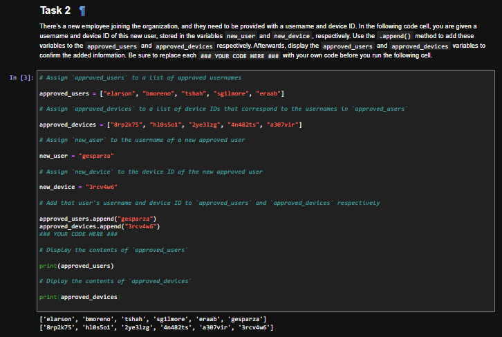
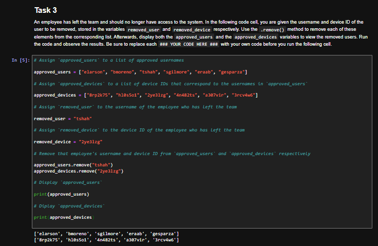
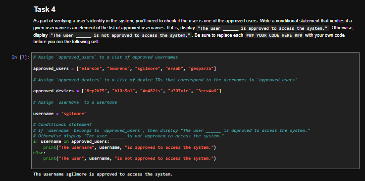
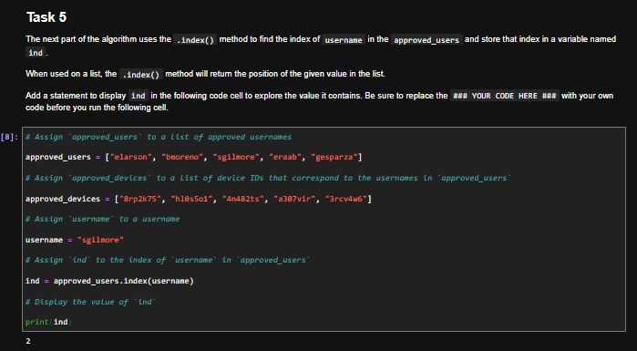
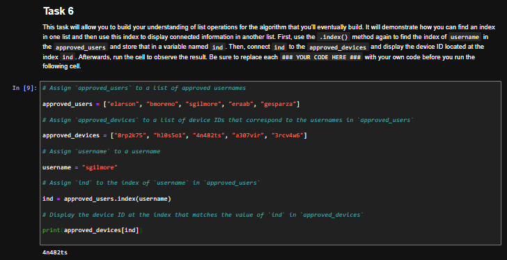
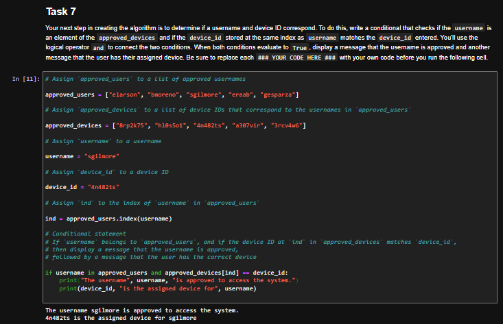
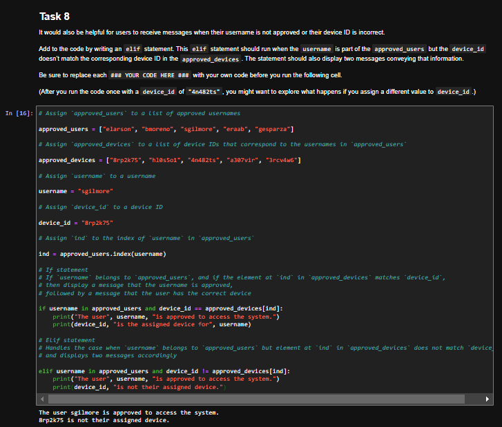
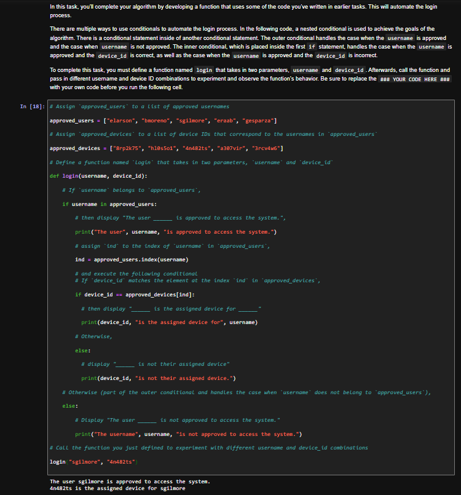

# Python Lists: Approved Users, Assigned Devices, and a Login Algorithm

## Summary

In this lab from the Google Cybersecurity Certificate (Automate Cybersecurity Tasks with Python), I used Python lists to maintain approved usernames and their assigned devices, then built a login algorithm that checks both the username and the device ID. The usernames and device IDs are sample data provided by the course.

## Tools Used

- Python 3
- Jupyter Notebook (course lab environment)

## Skills Demonstrated

- Adding and removing items with `.append()` and `.remove()`
- Parallel lists, where the same index links a user to their assigned device
- Membership checks with the `in` operator
- Finding a position with `.index()`
- Comparison with `==` and `!=`
- Combining conditions with `and`
- `if`/`elif`/`else` branching
- Nested conditionals
- Defining and calling a function with parameters

## Part 1: Updating the Approved Users and Devices

The lab uses two lists that stay in the same order: `approved_users` holds usernames, and `approved_devices` holds the device ID assigned to the user at the same index. These are called parallel lists. The starting lists are:

```python
approved_users = ["elarson", "bmoreno", "tshah", "sgilmore", "eraab"]
approved_devices = ["8rp2k75", "hl0s5o1", "2ye3lzg", "4n482ts", "a307vir"]
```

The pairing only holds if both lists are always updated together. If one list changes without the other, users after that point can be matched to the wrong device.

**Task 2: add a new user and device.** A new employee, `gesparza`, needs access, with device ID `3rcv4w6`. `.append()` adds each value to the end of its list. After the update, both lists print with the new entries at the end.

```python
approved_users = ["elarson", "bmoreno", "tshah", "sgilmore", "eraab"]
approved_devices = ["8rp2k75", "hl0s5o1", "2ye3lzg", "4n482ts", "a307vir"]

new_user = "gesparza"
new_device = "3rcv4w6"

approved_users.append("gesparza")
approved_devices.append("3rcv4w6")

print(approved_users)
print(approved_devices)
```



**Task 3: remove a user and device.** An employee who left the team, `tshah`, should no longer have access. Their device ID is `2ye3lzg`. `.remove()` takes each value out of its list. The printed lists no longer include that username or device.

```python
approved_users = ["elarson", "bmoreno", "tshah", "sgilmore", "eraab", "gesparza"]
approved_devices = ["8rp2k75", "hl0s5o1", "2ye3lzg", "4n482ts", "a307vir", "3rcv4w6"]

removed_user = "tshah"
removed_device = "2ye3lzg"

approved_users.remove("tshah")
approved_devices.remove("2ye3lzg")

print(approved_users)
print(approved_devices)
```



## Part 2: Checking a Username and Finding the Assigned Device

The remaining tasks use the lists after the addition and removal:

```python
approved_users = ["elarson", "bmoreno", "sgilmore", "eraab", "gesparza"]
approved_devices = ["8rp2k75", "hl0s5o1", "4n482ts", "a307vir", "3rcv4w6"]
```

**Task 4: check whether a username is approved.** `username` is set to `"sgilmore"`. The `in` operator checks whether that name is in `approved_users`. It is, so the cell prints `The username sgilmore is approved to access the system.`

```python
approved_users = ["elarson", "bmoreno", "sgilmore", "eraab", "gesparza"]
username = "sgilmore"

if username in approved_users:
    print("The username", username, "is approved to access the system.")
else:
    print("The user", username, "is not approved to access the system.")
```



**Task 5: find the username's index.** `.index(username)` returns the position of `"sgilmore"` in `approved_users`. Python counts from 0, and `sgilmore` is third on the list, so `ind` is `2`.

```python
username = "sgilmore"

ind = approved_users.index(username)

print(ind)
```



**Task 6: look up the device at that index.** Because the lists are kept in the same order, the device at index `ind` belongs to that user. `approved_devices[ind]` prints `4n482ts`, which is sgilmore's assigned device.

```python
username = "sgilmore"
ind = approved_users.index(username)

print(approved_devices[ind])
```



## Part 3: Completing the Login Algorithm

**Task 7: approve only when the user and device both match.** `device_id` is set to `"4n482ts"`. The `and` operator requires both conditions to be true: the username is in the approved list, and the device at `ind` equals the device that was entered. Both are true, so the cell prints that sgilmore is approved and that `4n482ts` is the assigned device for sgilmore.

```python
username = "sgilmore"
device_id = "4n482ts"
ind = approved_users.index(username)

if username in approved_users and approved_devices[ind] == device_id:
    print("The username", username, "is approved to access the system.")
    print(device_id, "is the assigned device for", username)
```



**Task 8: handle a mismatched device with `elif`.** An `elif` branch runs when the username is approved but the device does not match (`!=`). To test it, `device_id` is set to `"8rp2k75"`, which belongs to a different user. The `if` is false, the `elif` is true, and the cell prints two messages: that sgilmore is approved, and that `8rp2k75` is not their assigned device.

```python
username = "sgilmore"
device_id = "8rp2k75"
ind = approved_users.index(username)

if username in approved_users and device_id == approved_devices[ind]:
    print("The user", username, "is approved to access the system.")
    print(device_id, "is the assigned device for", username)
elif username in approved_users and device_id != approved_devices[ind]:
    print("The user", username, "is approved to access the system.")
    print(device_id, "is not their assigned device.")
```



**Task 9: wrap the checks in a `login()` function.** The final step puts the logic inside a function with two parameters, `username` and `device_id`. A nested conditional is used: the outer `if` checks whether the username is approved, then an inner `if`/`else` checks the device. The outer `else` handles a username that is not on the list. This structure also avoids calling `.index()` until the username is known to be approved, which would raise an error for an unknown user. Calling `login("sgilmore", "4n482ts")` prints that the user is approved and that `4n482ts` is the assigned device for sgilmore.

```python
approved_users = ["elarson", "bmoreno", "sgilmore", "eraab", "gesparza"]
approved_devices = ["8rp2k75", "hl0s5o1", "4n482ts", "a307vir", "3rcv4w6"]

def login(username, device_id):
    if username in approved_users:
        print("The user", username, "is approved to access the system.")
        ind = approved_users.index(username)
        if device_id == approved_devices[ind]:
            print(device_id, "is the assigned device for", username)
        else:
            print(device_id, "is not their assigned device.")
    else:
        print("The username", username, "is not approved to access the system.")

login("sgilmore", "4n482ts")
```



## Key Takeaways

- Parallel lists stay linked only when they are always updated together: the user at index 2 owns the device at index 2.
- `.append()` and `.remove()` keep an allow list current when people join or leave an organization.
- `in` checks whether a username is approved, and `.index()` finds that user's position so the matching device can be retrieved.
- `and` combines a username check with a device check, while `==` and `!=` distinguish a matching device from a wrong one.
- `elif` adds a branch for an approved user with the wrong device, without replacing the original `if`.
- Nested conditionals inside a function let the device check run only after the username is known to be approved, which also avoids calling `.index()` on a name that is not in the list.
- Automating these checks is a simple form of access control: both the user and their assigned device have to match before access is treated as valid.
